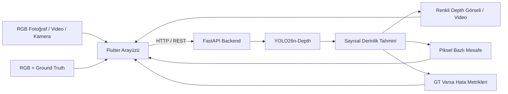

<div align="center">

# DepthLab

### Tek Kameradan Derinlik Tahmini ve Görselleştirme Platformu

**Monocular Depth Estimation · Flutter · FastAPI · YOLO26n-Depth**


*RGB görüntülerden tahmini derinlik haritaları üreten; fotoğraf, video, kamera ve Ground Truth değerlendirmesini tek arayüzde birleştiren uygulama.*

</div>

---

## Proje Hakkında

**DepthLab**, tek bir RGB kameradan elde edilen görüntüler üzerinde **monocular depth estimation** gerçekleştirmek amacıyla geliştirilen bir bilgisayarlı görü projesidir. Sistem, **Flutter/Dart** arayüzünü **Python/FastAPI** servisi ve **Ultralytics YOLO26n-Depth** modeliyle birleştirir.

Amaç yalnızca renkli derinlik haritası üretmek değil; tahminleri orijinal görüntü ile karşılaştırmak, seçilen piksellerin tahmini uzaklıklarını incelemek ve uygun **Ground Truth (GT)** verisi bulunduğunda nicel performans değerlendirmesi yapabilmektir.

> **Proje durumu:** Bu depo geliştirme/prototip sürümünün kaynak kodunu içerir. Aşağıdaki özellikler kodda yer alsa da bütün platformlarda uçtan uca çalıştıkları ayrıca doğrulanmalıdır. Üretim ortamına hazır bir servis olarak değerlendirilmemelidir.

## Sistem Mimarisi



## Başlıca Özellikler

| Modül | Kapsam | Kod durumu |
| --- | --- | --- |
| **Fotoğraf analizi** | RGB fotoğraftan renkli derinlik haritası oluşturma | Uygulandı |
| **Kamera ile fotoğraf çekimi** | Fotoğraf yakalama ve ardından analiz | Uygulandı |
| **Video analizi** | Kısa videodan işlenmiş depth videosu üretme ve oynatma | Uygulandı; ortam bağımlı |
| **Canlı kamera** | Kareleri API'ye göndererek derinlik görselleştirme | Uygulandı; ortam bağımlı |
| **Görsel karşılaştırma** | RGB/depth karşılaştırması ve opaklığı ayarlanabilen overlay | Uygulandı |
| **Piksel bazlı sorgulama** | Seçilen konumun tahmini derinliğini görüntüleme | Uygulandı |
| **Ground Truth testi** | RGB ve 16-bit depth eşleşmesiyle sayısal değerlendirme | Uygulandı |
| **Hata metrikleri** | MAE, RMSE, AbsRel, δ1 ve geçerli GT piksel oranları | Uygulandı |
| **Dosya indirme butonları** | Depth PNG / MP4 dosyasını doğrudan arayüzden indirme | Henüz etkin değil |

**Not:** “Uygulandı” ifadesi ilgili işlevin kaynak kodda bulunduğunu belirtir; farklı işletim sistemi, tarayıcı ve fiziksel cihazlarda test edilmiş olduğu anlamına gelmez.

## Kullanılan Teknolojiler

| Katman | Teknolojiler |
| --- | --- |
| İstemci | Flutter, Dart, Material 3 |
| Sunucu | Python, FastAPI, Uvicorn |
| Model | Ultralytics YOLO26n-Depth (`yolo26n-depth.pt`) |
| Görüntü / video işleme | OpenCV, NumPy, imageio-ffmpeg |
| İletişim | HTTP / REST, multipart form-data, JSON |
| Flutter paketleri | `image_picker`, `video_player`, `camera`, `http` |

## Depo Yapısı

GitHub deposunda mevcut proje **`DepthLab/` alt klasöründe** yer almaktadır:

```text
DepthLab/                        # GitHub depo kökü
├── README.md                    # Bu tanıtım dosyası (depo köküne eklenir)
└── DepthLab/                    # Uygulama kaynak kodları
    ├── flutter_app/
    │   ├── lib/
    │   │   └── main.dart        # Flutter arayüzü
    │   └── pubspec.yaml         # Flutter bağımlılıkları
    ├── backend/
    │   └── server.py            # FastAPI ve inference API
    └── README.md                # Önceki proje notları
```

> Model ağırlıkları, eğitim veri setleri ve API çalışma çıktıları kaynak kodun parçası olarak varsayılmamalıdır.

## Kurulum ve Çalıştırma

### Ön Koşullar

- Python **3.11** (projenin geliştirildiği sürüm) veya uyumlu sürüm
- Flutter SDK ve Dart; Flutter web desteği etkin bir ortam
- YOLO26n-Depth model ağırlığı: **`yolo26n-depth.pt`**
- Bağımlılıkları kurabilmek için internet bağlantısı

### 1. Depoyu klonlayın

```bash
git clone https://github.com/mavinci-tr/DepthLab.git
cd DepthLab/DepthLab
```

### 2. Backend'i kurun ve çalıştırın

```bash
cd backend
python -m pip install fastapi "uvicorn[standard]" python-multipart ultralytics opencv-python numpy imageio-ffmpeg
```

**Model dosyasını** `backend/yolo26n-depth.pt` yoluna yerleştirin. Model, servis başlatılırken yüklenir; dosya bulunmazsa backend başlatılamayabilir.

```bash
python -m uvicorn server:app --host 127.0.0.1 --port 8000
```

Yerel kontrol adresleri:

- Sağlık kontrolü: [http://127.0.0.1:8000/health](http://127.0.0.1:8000/health)
- Etkileşimli API dokümantasyonu: [http://127.0.0.1:8000/docs](http://127.0.0.1:8000/docs)

### 3. Flutter arayüzünü başlatın

Yeni bir terminal açıp **depo içindeki proje klasörüne** (`DepthLab/DepthLab`) gidin:

```bash
cd flutter_app
flutter pub get
flutter run -d chrome
```

> Flutter ve backend aynı bilgisayarda çalışıyorsa yerel web testi için API adresi `http://127.0.0.1:8000` olabilir. `flutter_app/lib/main.dart` dosyasındaki `apiBaseUrl` ve Ground Truth ekranındaki `_apiBaseUrl` tanımları mevcut geliştirme sürümünde ayrı tutulmaktadır. Telefon veya başka bir bilgisayardan erişim için iki adresi de uygun sunucu IP'sine göre düzenleyin; backend ağ yapılandırmasını ve güvenlik ayarlarını ayrıca değerlendirin.

## Kullanım Senaryoları

**Fotoğraf:** Görseli seçin veya kamera ile fotoğraf çekin → analizi başlatın → RGB ve depth sonuçlarını karşılaştırın → ilgili piksele dokunarak tahmini uzaklığı sorgulayın.

**Video:** Desteklenen kısa videoyu seçin → API üzerinde derinlik videosunu oluşturun → sonuç videosunu görüntüleyin ve uygun karede piksel bazlı sorgulama yapın.

**Canlı kamera:** Kameradan alınan kareleri backend'e göndererek güncellenen RGB/depth görsellerini inceleyin. Performans, cihazın işlem gücüne ve ağ koşullarına bağlıdır.

**Ground Truth değerlendirmesi:** Eşleşen RGB görüntüsü ile gerçek derinlik haritasını yükleyin → tahmin, GT ve hata haritalarını karşılaştırın → metrikleri ve piksel bazlı hatayı inceleyin.

### Ground Truth Dosya Gereksinimleri

`/evaluate-depth` uç noktası, **Depth8 biçimindeki milimetre ölçekli 16-bit tek kanallı PNG** verisini bekler:

- RGB ve GT dosyalarının **temel adı aynı** olmalıdır (örnek: `sample01.jpg` ve `sample01.png`).
- RGB ve GT **aynı çözünürlükte** olmalıdır.
- GT verisi `uint16` PNG olmalıdır; 8-bit renkli görseller uygun değildir.
- Derinlik dönüşümü: **`metre = PNG_piksel_değeri / 1000`**.
- Metrikler, GT ile tahminin birlikte geçerli olduğu pikseller üzerinden hesaplanır.

**Önemli:** Bu kabul edilen biçim her veri seti için geçerli değildir. Örneğin farklı ölçekli depth PNG'leri veya stereo disparity verisi, gerekli ön işleme yapılmadan bu ekrana doğrudan yüklenmemelidir.

### Değerlendirme Metrikleri

| Metrik | Anlamı | Yorum |
| --- | --- | --- |
| **MAE (m)** | Mutlak derinlik hatalarının ortalaması | Düşük daha iyi |
| **RMSE (m)** | Kareli hataların kök ortalaması | Düşük daha iyi |
| **AbsRel** | Mutlak hatanın GT derinliğine oranının ortalaması | Düşük daha iyi |
| **δ1 (%)** | Tahmin/GT oranı 1.25 eşiğinin içinde kalan piksel oranı | Yüksek daha iyi |
| **GT coverage** | GT'nin görüntüde kapsadığı geçerli alan | Yüksek daha kapsamlı |

## API Uç Noktaları

| Yöntem | Endpoint | Amaç |
| --- | --- | --- |
| `GET` | `/health` | API durumunu kontrol etme |
| `POST` | `/predict` | Fotoğraftan renkli depth PNG üretme |
| `GET` | `/depth-at/{result_id}` | Fotoğrafta `(x, y)` konumunun tahmini derinliği |
| `POST` | `/predict-video` | Videoyu derinlik videosuna dönüştürme |
| `GET` | `/results/{result_id}.mp4` | İşlenmiş videoyu görüntüleme |
| `GET` | `/video-depth-at/{result_id}` | Video karesi ve pikseli için tahmini derinlik |
| `POST` | `/predict-live` | Kamera karesinden RGB/depth sonucu alma |
| `POST` | `/evaluate-depth` | RGB + GT üzerinden hata metrikleri hesaplama |
| `GET` | `/evaluation-at/{evaluation_id}` | Seçilen pikselde tahmin, GT ve mutlak hata |

İstek/yanıt ayrıntıları için çalışan servisin `/docs` sayfasına bakın.

## Prototip Sınırları ve Teknik Notlar

- **Fotoğraf:** En fazla **12 MB**.
- **Video:** En fazla **50 MB** ve **10 saniye**; işleme sırasında yaklaşık en fazla **4 FPS** örneklenir ve kare genişliği en fazla **640 px** olacak şekilde küçültülür.
- **Canlı kamera:** İstek başına en fazla **6 MB**; kare genişliği en fazla **640 px** olacak şekilde küçültülür.
- **GT değerlendirmesi:** RGB ve GT dosyalarının her biri en fazla **12 MB**.
- **Model:** API şu anda **önceden eğitilmiş `yolo26n-depth.pt`** dosyasını kullanacak şekilde yapılandırılmıştır. Fine-tuning ve bağımsız veri seti deneylerinin sonuçları, API'ye entegre edilmiş bir modelin doğrulanmış performansı olarak yorumlanmamalıdır.
- **Doğruluk:** Renkli depth haritası bir görselleştirmedir; tek başına fiziksel ölçüm doğruluğunu kanıtlamaz. Uzaklık tahminleri uygulama alanına uygun GT verisiyle sınanmalıdır.
- **Güvenlik:** Sunucu kimlik doğrulaması içermeyen yerel geliştirme prototipidir; ek korumalar olmadan açık internete sunulmamalıdır.
- **Depolama:** API'nin `backend/results/` klasörüne yazdığı `.npy`, `.npz` ve `.mp4` sonuçları geçici/yerel çalışma verileridir. Düzenli temizlik ve sürüm kontrolünden hariç tutma önerilir.

## Geliştirme Yol Haritası

- [x] Flutter arayüzü ile FastAPI bağlantısının kodlanması
- [x] Fotoğraf ve video depth inference akışları
- [x] Canlı kamera API akışı
- [x] Piksel bazlı uzaklık sorgulama
- [x] Ground Truth karşılaştırması ve hata metrikleri
- [ ] PNG / MP4 çıktılarının arayüzden indirilebilmesi
- [ ] Platformlar arası uçtan uca testler ve otomatik testler
- [ ] API adresinin ortam değişkeni / uygulama ayarı üzerinden yönetimi
- [ ] Bağımsız test sonuçlarının ve fine-tuned model entegrasyonunun belgelenmesi
- [ ] Dağıtım, yetkilendirme ve güvenlik yapılandırmasının tamamlanması

## Proje Bağlamı

DepthLab, **Mavinci** organizasyonunda geliştirilen bir bilgisayarlı görü / derinlik tahmini çalışmasıdır. Veri seti incelemeleri, model karşılaştırmaları ve fine-tuning deneyleri bu uygulamanın araştırma-geliştirme sürecini desteklemektedir; her deneyin dosyaları ve eğitim ağırlıkları bu kod deposunda bulunmak zorunda değildir.

---

<div align="center">

**DepthLab** · *Computer Vision · Monocular Depth Estimation · Flutter & FastAPI*

[GitHub Repository](https://github.com/mavinci-tr/DepthLab)

</div>
